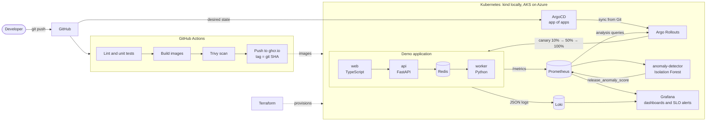
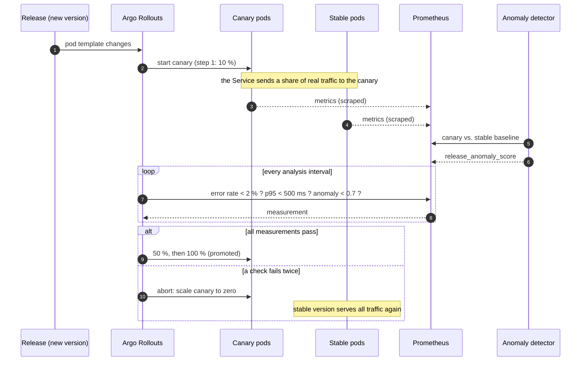

# Release Guardian

**A self-healing release platform on Kubernetes.** Every new version is rolled
out as a canary, judged on live Prometheus metrics and an anomaly score, and
rolled back automatically if it misbehaves.

[](https://github.com/RouaSmida/release-guardian/actions/workflows/ci.yml)
[](https://github.com/RouaSmida/release-guardian/actions/workflows/e2e.yml)
[](https://github.com/RouaSmida/release-guardian/actions/workflows/chart.yml)
[](https://github.com/RouaSmida/release-guardian/actions/workflows/terraform.yml)

```bash
make up
```

```bash
make demo-bad
```

Two commands: a local cluster with the whole platform, then a broken release
that is caught and rolled back while you watch.

---

## The problem

Most outages start with a deployment. A Kubernetes rolling update asks one
question — *does the new pod pass its health probes?* — and then replaces every
old pod. A version that starts correctly but fails half of its requests passes
that check and takes the service down with it.

Release Guardian changes the question to *"does the new version behave well
for real users?"* and lets the platform act on the answer:

| | Rolling update | Release Guardian |
|---|---|---|
| Exposure of a new version | all traffic, progressively | a small share first (canary) |
| What decides success | health probes | error rate, p95 latency, anomaly score |
| When a release is bad | someone notices and rolls back | the rollout is aborted automatically |
| Proof that it works | — | an end-to-end test in CI that releases a broken version |

## Architecture



## The rollback, step by step



This is the output of `make demo-bad FAULT_MODE=latency` in an
[end-to-end workflow](https://github.com/RouaSmida/release-guardian/actions/workflows/e2e.yml)
run on `main` (timestamps removed, repeated lines shortened):

```text
==> Releasing api v2 -> v3-broken (FAULT_MODE=latency)
    canary steps: 10% -> pause -> 50% -> pause -> 100%
    analysis    : error rate < 2%, p95 latency < 500 ms, anomaly score < 0.7

==> Watching the rollout
    [  1s] phase=Progressing step=0/4  canary pods=0  stable pods=2  analysis=           anomaly score=0
    [  6s] phase=Paused      step=1/4  canary pods=1  stable pods=2  analysis=Running    anomaly score=0
    [ 17s] phase=Paused      step=1/4  canary pods=1  stable pods=2  analysis=Running    anomaly score=0.84
    ...
    [ 51s] phase=Paused      step=3/4  canary pods=1  stable pods=1  analysis=Running    anomaly score=0.84
    [ 57s] phase=Degraded    step=0/4  canary pods=1  stable pods=2  analysis=Failed     anomaly score=0.84
  ✔ Argo Rollouts ABORTED the rollout after 57s
    reason: Metric "p95-latency" assessed Failed due to failed (2) > failureLimit (1)
  ✔ anomaly detector scored the canary: peak release_anomaly_score = 0.85

==> Verifying the automatic rollback
  ✔ canary pods are gone; all traffic is served by v2 again

==> Restoring the desired state
  ✔ rollout/api is Healthy

  ROLLBACK VERIFIED: the broken release never reached more than a share of traffic.
```

The broken version keeps passing its health probes the whole time — only the
metric analysis catches it.

### What the end-to-end test verifies

Every run of the workflow creates a fresh kind cluster and asserts, in order:

| Scenario | Assertion |
|----------|-----------|
| Healthy release | Promoted to 100 % — with analysis that fails on missing data, so the canary was really measured |
| Failing release (`FAULT_MODE=errors`) | Rollout aborted, canary pods gone, only the previous version serving |
| Slow release (`FAULT_MODE=latency`) | Same, **and** `release_anomaly_score` was above 0 between the release and the abort |

What it does not verify: in both broken scenarios the abort message names the
threshold check (`error-rate` or `p95-latency`). The anomaly score was above
its 0.7 limit as well, but no test isolates a rollback caused *only* by the
anomaly analysis, and the score of a healthy canary is not asserted.

## What is in the box

| Area | What it does | Where |
|------|--------------|-------|
| **Demo application** | `web` (TypeScript), `api` (FastAPI), `worker` (Python) with `/healthz`, `/readyz`, `/metrics`, JSON logs and a `FAULT_MODE` switch to break a release on purpose | [`apps/`](apps) |
| **CI** | Lint, unit tests, multi-stage image builds, Trivy scan (fails on fixable criticals), push to ghcr.io tagged with the git SHA | [`ci.yml`](.github/workflows/ci.yml) |
| **Delivery** | One Helm chart: Rollouts with canary steps, AnalysisTemplates, probes, limits, PDB, HPA, hardened security context | [`deploy/charts/release-guardian`](deploy/charts/release-guardian) |
| **GitOps** | ArgoCD app-of-apps: the cluster state comes from this repository | [`deploy/argocd`](deploy/argocd) |
| **Observability** | kube-prometheus-stack and Loki values, three Grafana dashboards as code, SLO burn-rate alerts (99.5 % availability) | [`deploy/observability`](deploy/observability), [`dashboards/`](deploy/charts/release-guardian/dashboards) |
| **AIOps** | `anomaly-detector`: Isolation Forest over the canary's error rate and p95 latency versus the stable baseline, exposed as `release_anomaly_score` | [`apps/anomaly-detector`](apps/anomaly-detector) |
| **End-to-end proof** | GitHub Actions creates a kind cluster, releases a healthy, a failing and a slow version, and asserts promotion, rollback and a non-zero anomaly score | [`e2e.yml`](.github/workflows/e2e.yml), [`scripts/`](scripts) |
| **Infrastructure as code** | Terraform for Azure: AKS (free control plane, one small node), Log Analytics, remote state, GitHub OIDC — validated, never applied automatically | [`infra/`](infra) |

## Tech stack

| Layer | Tools |
|-------|-------|
| Application | TypeScript, Node.js 22, Express · Python 3.13, FastAPI · Redis |
| Containers | Docker multi-stage builds, non-root, Trivy |
| CI/CD | GitHub Actions, GitHub Container Registry, Dependabot |
| Delivery | Kubernetes, Helm, Argo Rollouts, ArgoCD |
| Observability | Prometheus (Operator), Grafana, Loki, Alloy, Alertmanager |
| AIOps | scikit-learn Isolation Forest |
| Infrastructure | Terraform, Azure (AKS, Log Analytics, Storage), OIDC federation |
| Local | kind, Make, Bash |

## Run it locally

Requirements: Docker, [kind](https://kind.sigs.k8s.io/), kubectl, Helm 3, make.

```bash
make up
```

Creates a kind cluster with Argo Rollouts, Prometheus, Grafana, Loki and
version 1 of the application (`make up PROFILE=lean` skips Grafana and Loki).

```bash
make demo-good
```

A healthy release: promoted from 10 % to 50 % to 100 %.

```bash
make demo-bad
```

A broken release: aborted and rolled back. Try `make demo-bad FAULT_MODE=latency`
for a slow release instead of a failing one; that variant also checks the anomaly score.

```bash
make grafana
```

Port-forwards Grafana and prints the URL and credentials. Open the
*Canary progress* dashboard while a demo runs.

```bash
make down
```

`make help` lists every target. Details and troubleshooting:
[docs/RUNBOOK.md](docs/RUNBOOK.md).

## Repository layout

```text
apps/                     web, api, worker, anomaly-detector (code, tests, Dockerfiles)
deploy/
  charts/release-guardian/  Helm chart: Rollouts, analysis, monitoring, dashboards
  argocd/                   app-of-apps GitOps layout
  observability/            Helm values for kube-prometheus-stack, Loki, Alloy
infra/
  bootstrap/                remote state storage + GitHub OIDC identity (run once)
  platform/                 resource group, Log Analytics, AKS
scripts/                  up, release, diagnostics, down (shared by Makefile and CI)
.github/workflows/        ci, chart, e2e, terraform
docs/                     LEARNING, INTERVIEW, RUNBOOK
```

## Design decisions

- **The demo fails where probes cannot see it.** `FAULT_MODE` never affects
  `/healthz` or `/readyz`. A release that fails its probes is already handled
  by Kubernetes; the one that passes them and still hurts users is the reason
  metric analysis exists.
- **The canary is judged on its own metrics.** A PodMonitor copies the
  pod-template hash onto every metric, and the analysis queries filter on the
  canary's hash, so a bad canary is not hidden in a healthy average.
- **Thresholds and an anomaly score, side by side.** Fixed limits (2 % errors,
  500 ms p95) are easy to reason about; the Isolation Forest adds a relative
  check for regressions that stay under those limits. The model is small and
  explainable on purpose.
- **One chart, one loop.** All three services are rendered from one `services:`
  map, so none of them can miss a probe, a limit or a disruption budget.
- **The test is the demo.** CI and `make demo-bad` run the same scripts, so
  the end-to-end proof cannot drift from what a person sees locally.
- **No stored cloud credentials.** GitHub Actions authenticates to Azure
  through OIDC federation; images are pushed with the built-in workflow token.
- **Everything pinned.** Actions, charts, tools and dependencies have explicit
  versions (`scripts/versions.env`, workflows, lockfiles); Dependabot proposes updates.

## Scope and limitations

Being explicit about what this project does not do:

- Canary weights are approximated by pod counts; there is no traffic router,
  so "10 %" with two replicas is one canary pod out of three.
- Analysis fails closed: a canary without metrics or without traffic is
  aborted rather than promoted. A service therefore needs traffic to be
  released; the demo uses a load generator.
- The broken release is simulated with a flag, not a real defect.
- The anomaly detector is an illustration of the technique and has not been
  evaluated on real incident data. A rollback triggered by the anomaly
  analysis alone has not been demonstrated.
- The Terraform code is formatted, validated and linted in CI but has not been
  applied from this repository. The ArgoCD layout and the Loki/Alloy values
  are not covered by the CI end-to-end test, which uses a lean Prometheus profile.
- Deploying to Azure creates billable resources. Read the cost warning and the
  destroy steps in [docs/RUNBOOK.md](docs/RUNBOOK.md#2-deploy-to-azure-aks) first.

## Documentation

| Document | For |
|----------|-----|
| [docs/LEARNING.md](docs/LEARNING.md) | Every component and file explained in plain language, with the reasoning and the alternatives |
| [docs/RUNBOOK.md](docs/RUNBOOK.md) | Run locally, deploy to Azure, verify, destroy, troubleshoot |
| [docs/INTERVIEW.md](docs/INTERVIEW.md) | Twenty likely interview questions with concise answers |
| [PLAN.md](PLAN.md) | The implementation plan |
